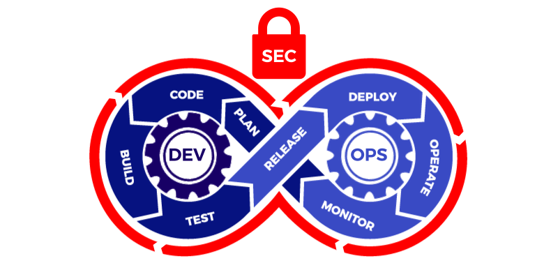
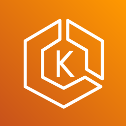
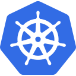
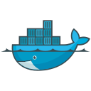
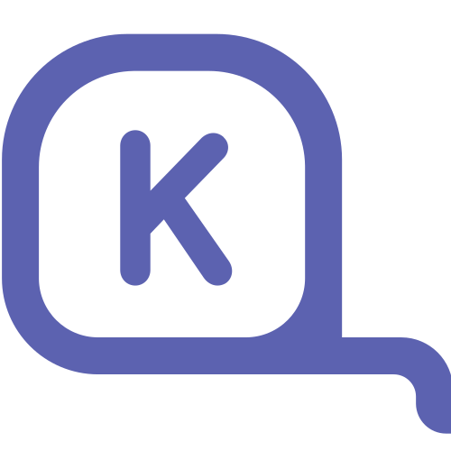
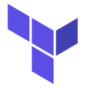
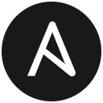
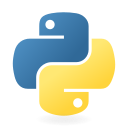
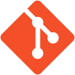

# Jagan Mohan Yangala

**DevOps & Platform Engineer** · Bengaluru, India

I build and operate Kubernetes platforms on AWS. My work spans infrastructure as code, GitOps, CI/CD, and production troubleshooting.

[LinkedIn](https://www.linkedin.com/in/jaganmohan-y) · [Email](mailto:yangalajaganmohan44@gmail.com)

  

## What I work on

- **Kubernetes operations.** Run and upgrade Amazon EKS clusters, manage node provisioning with Karpenter, and troubleshoot scheduling, networking, and Istio traffic.
- **GitOps and delivery.** Deploy applications with Argo CD ApplicationSets and Helm. Build reusable GitHub Actions workflows, operate self-hosted runners with Actions Runner Controller (ARC), and promote the same build artifact across environments.
- **Infrastructure as code.** Maintain Terraform modules and manage state, imports, and drift in HCP Terraform.
- **Secrets and artifacts.** Deliver application secrets through HCP Vault and Vault Secrets Operator. Administer Nexus Repository Pro and support repository migrations.
- **Production reliability.** Build New Relic dashboards and alerts, investigate logs with Graylog and OpenSearch, and write runbooks for on-call teams.

## Tech stack

<!-- Icon sources include Devicon, SVG Logos, Simple Icons, the Karpenter project, and AWS Architecture Icons. -->

| Area | Tools |
| --- | --- |
| **Cloud & containers** |       AWS, Amazon EKS, Kubernetes, Docker, Karpenter, Istio |
| **Infrastructure as code** |      Terraform, HCP Terraform, Ansible, AWS CloudFormation, AWS CDK |
| **GitOps & CI/CD** |       Argo CD, Helm, GitHub Actions, ARC, GitLab CI, Jenkins |
| **Secrets & artifacts** |     HCP Vault, Vault Secrets Operator, Nexus Repository Pro, Amazon ECR |
| **Observability** |      New Relic, Graylog, OpenSearch, Prometheus, Grafana |
| **Scripting & tooling** |       Bash, Python, PowerShell, TypeScript, Linux, Git |

## Experience

- **Scientific Games · Software Engineer** (May 2025–Present) — Production Kubernetes on AWS, GitOps, CI/CD, and infrastructure automation.
- **GlobalLogic · Software Engineer** (Apr 2022–Apr 2025) — Terraform on Azure, AWS migration and infrastructure automation, and microservices on Google Cloud using KubeSphere.

## GitHub activity

  

  

